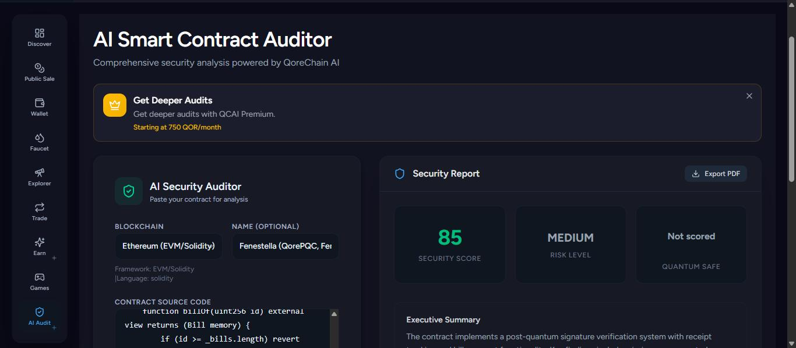

# QCAI audit and our response

On 16 November 2026 we ran all three contracts (`QorePQC.sol`, `FenestellaReceipts.sol`, `Bills.sol`, flattened into one file) through the **QoreChain AI Smart Contract Auditor** on the QoreChain Dashboard (paid audit, 150 QOR).

**Result: security score 85, risk level medium, 4 findings.**

|  |  |
| --- | --- |

The auditor's summary: *"While the core cryptographic functions appear secure, the lack of proper access controls and potential DoS vectors require attention."* We took each finding seriously, checked it against the code, and did something about every one that held.

## Findings

### 1. HIGH: missing access control on `createBill`

> Any user can create bills for any payer, potentially leading to unauthorized bill creation.

**Assessment: true as stated; by design for the contract, and it exposed a real weakness in our server.**

A bill is a *request*, not a debt. Like an invoice, anyone may send one. What matters is who can pay it, and that is locked down:

- only the named payer can pay (`NotThePayer`), only the exact amount (`WrongAmount`), only once (`AlreadyPaid`);
- the payer's agent pays only a bill named in a mandate the owner sealed and anchored with their ML-DSA-87 key, after the agent's AI approves it, within the chain-enforced spending rule;
- the agent's AI flags a payee the owner has never paid (`new_payee`).

Restricting `createBill` to an allowlist would need an owner or a registry, and the contract deliberately has neither.

**But the finding was right about one thing.** Our server listed an owner's bills by reading the **newest 30 bills** of the contract. Someone posting a flood of bills to other people could push the owner's real bill out of that window, so the agent and its AI would no longer see it. That is a denial of service against our product, not against the contract.

**Fixed:**
- [`lib/agent/server.ts`](lib/agent/server.ts) `billsFor()` now finds every bill through the `BillCreated` event filtered by the **indexed `payer`** topic, scanning from the deployment block in 10,000-block chunks (the testnet RPC's limit) with a per-owner cache. Bills addressed to other people never enter the scan, however many there are. Checked on testnet against a full read of the contract: every payer's bills match.
- New Foundry test `test_unsolicited_bill_moves_nothing`: a spammer posts 50 bills of 100 QOR to the payer. No balance moves, the contract holds nothing, the spammer cannot pay on the payer's behalf, and the real bill stays intact and payable.

### 2. MEDIUM: potential overflow in nonce management

> `nonces` uses uint256 which could theoretically overflow after 2^256 − 1 transactions per account, though practically unlikely.

**Assessment: not exploitable.** The contracts compile with Solidity `^0.8.24`, where `nonces[account]++` is checked arithmetic and reverts on overflow instead of wrapping. Reaching 2^256 receipts for one account is not physically possible. No change.

### 3. LOW: unbounded storage growth in `_bills`

> The `_bills` array grows unbounded with each bill created, potentially leading to gas limit issues or denial-of-service when querying large arrays.

**Assessment: no on-chain risk; the off-chain part was real and is fixed with finding 1.** The contract never iterates over `_bills`: `pay` and `billOf` read one element by index (constant gas), and `count` returns the length. Growth costs only the poster's gas. The query-side concern applied to our server's listing, which no longer depends on the array's size.

### 4. INFO: no ERC compliance required

Correct; these are application contracts. No change.

## Not scored: "Quantum safe"

The auditor marked the quantum-safety score "Not scored" for the EVM/Solidity target. The contracts' post-quantum properties are covered by our own tests instead: `FenestellaReceipts` accepts a record only with an ML-DSA-87 signature verified by the chain's `pqcVerify` precompile and never trusts `msg.sender`; `QorePQC` fails closed when a precompile is inactive. See the 11 receipt tests in [`contracts/test/Fenestella.t.sol`](contracts/test/Fenestella.t.sol), the [real receipt on testnet](https://fenestella.vercel.app/tx/0xfa030023c46c526dd07eab33be5cda41c3de3e9a5aaced2498dfe084cbd7541f), and [THREAT_MODEL.md](THREAT_MODEL.md).

## Why the deployed contracts were not redeployed

None of the findings needed a contract change, and the deployed addresses are registered for the Q-Day Drill. The exact source audited is the source in [`contracts/src`](contracts/src).
